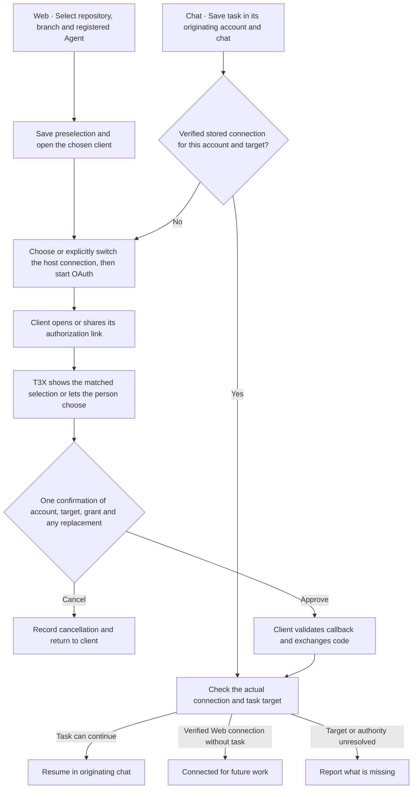
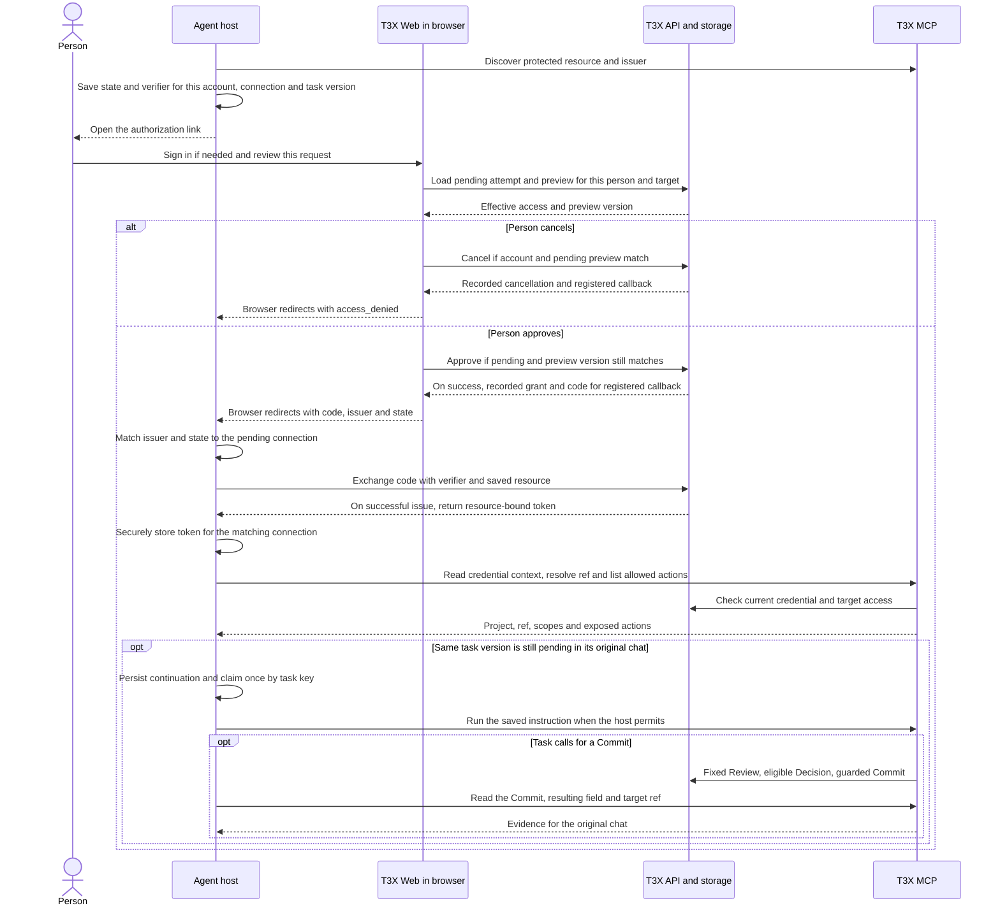
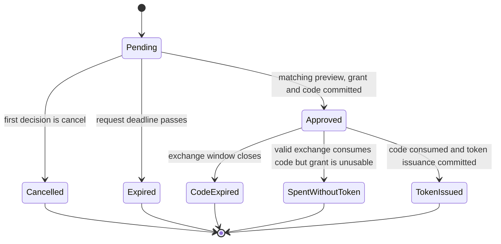

# Coordinating MCP authorization across Web and Chat

**Authorization design · 2026-11-26 · evaluation baseline `98381f08f`.** A person can start in T3X Web or give a task to an Agent in Chat. Both entries lead to one consent screen for a live client request. The T3X API owns repository access, the client owns the connection and the original conversation, and the repository records the outcome of the work.

**Product decision.** When the client is offline, Web lets the person choose the repository and registered Agent. The person confirms once when the client starts connecting. Preselection issues no credential and leaves the current grant usable. Codex default authorization is deferred. A Codex client using explicit OAuth can already participate in the Chat path.

## What the baseline evaluation found

| Observation from the November 26 local evaluation | Design consequence |
| --- | --- |
| At 13:13:17 the native client received `access_denied` and closed its loopback listener. At 13:14:08 an old Web page accepted approval for the same request. The browser reached a closed port. No code exchange followed. | Record cancellation before redirecting. Every tab must see the same final decision for this attempt. A new connection needs a fresh client request. |
| A separate native Codex test chat completed one Web confirmation and went from zero to 26 tools. The acceptance client sent the next instruction to that same chat and approved Decision and Commit separately. The target field was read back from T3X Commit `89b3a33` on `main`. | There is evidence for the connection and the business result. Automatic resumption in the user's desktop chat still needs a host-level test. Tool counts vary by deployment. |
| After reauthorization, a new Agent could read an earlier Draft. Its fixed Review contained edits by both Agent identities. Self-approval returned 403 and `main` stayed at its prior head. | Keep authorship across rotations. Show the fixed Review and the required reviewer when the current Agent cannot decide it. |

The baseline HTTP deployment supported protected-resource discovery, Web consent, S256 PKCE and per-request API authentication. Approval rotated the existing credential for the same T3X user, project and registered client and created a five-minute, single-use code in one transaction. Cancellation returned a redirect without recording the decision. Repository Settings directed new users to Chat. The flow below adds a direct Web entry and persists the outcome before returning to the client. [Deployment and registration](../README.md#repository-delegation-with-oauth) · [Consent and exchange](../../../packages/api/src/routes/mcp-delegations.openapi.ts) · [Grant rotation](../../../packages/api/src/lib/repository-agent-delegation.ts) · [Repository settings](../../web/src/components/project/agent-access/RepositoryAgentAccess.tsx)

## Two entries, one confirmation

**From Web.** Add **Connect an Agent** to repository Agent access. A direct visit lets the signed-in person choose a repository they can delegate. Save their user ID, project ID, intended branch and registered client in a short-lived preselection. **Continue in client** opens a connection-start destination configured by the deployment for that client and passes an opaque reference. If the registry has no such destination, show how to open the client's connection settings. The client generates its own OAuth request and verifier.

At consent, the API validates a returned reference against its owner, client, expiry and requested target. Bind the selection to exactly one attempt, atomically with approval. Reject a conflicting target, an expired selection or a claim by a different attempt. Retries of the winning attempt read its recorded outcome. Without a reference, the person can explicitly select **Use this saved selection** on the consent form, even if only one matches, or proceed as a new request. The same **Authorize** click confirms that choice. A different host instance using the same client ID cannot silently claim it.

**From Chat.** Save the task under the originating host account and chat. Reuse a suitable credential held for that account and target, or show the host's OAuth link. Include `repository=owner/name` and `branch` when known. An omitted repository opens the picker. An inaccessible or conflicting target stops the request. After exchange, compare the actual project and ref with the saved instruction before resuming. Keep task text at the host. For compatibility, accept a legacy `task` parameter as ignored input and strip it before login redirects, rendering or diagnostic capture. Configure the ingress to omit raw query strings from logs. [Host integration](../README.md#repository-delegation-with-oauth)

**Connection choice.** The host identifies its signed-in account and connection. In Chat it can reuse verified access for the known person and task target. A Web preselection reference is opaque to the host. Route it through OAuth and the signed-in consent page, even if a cached credential opens the same project. Two T3X users can manage that project and own different private Workspaces. If the person independently chooses to work through an existing host connection, only that host can report its verified account and project. The Web preselection stays unclaimed and expires normally.

If the host already uses this MCP URL for repository A and Web selects B, it must explicitly start a new connection or switch the existing one. A host with multiple slots can keep A. A single-slot host explains the switch and pauses A's tasks. If the host offers neither action, leave Web at “Waiting for client” with its setup instructions. A successful probe using A's credential cannot complete B's setup.

Switching host accounts invalidates a pending handoff. For a renewal, preserve the intended T3X account as well as the project. If the host cannot establish that account continuity, treat the result as a new connection and leave the previous account's tasks paused. T3X separately rotates the previous grant for the same T3X user, project and registered client. Every device using that grant will lose access. [Grant rotation](../../../packages/api/src/lib/repository-agent-delegation.ts)

**At consent.** Show the signed-in T3X account, registered client, repository and actual read/write scope above **Authorize**. For example, “Read this repository. Edit content on all branches subject to their rules. On `main`, this Agent can commit its own eligible changes after checks pass.” For a single writable branch, say “Read this repository. Edit content only on `main`.” For read-only access, say “Read this repository.” Show what the selected mode permits and who must approve this task on its target branch. Keep duration (seven days by default) and scope controls in advanced settings. Link to revocation in repository Settings. [Repository delegation](business-capabilities.md#repository-delegation)

Show which grant a new approval would replace. Refresh the server-issued preview when the person changes advanced settings and enable **Authorize** once the displayed version is current. The API binds both approval and cancellation to the account and attempt that produced that preview. If the browser account changes, the original person can return to their attempt, or the client can start a fresh request for the other account. [Concurrency and expiry](#closing-an-attempt-and-recovering-the-task)

## What each participant can prove

The signed-in T3X person delegates access and remains the owner of their private Workspace. The registered client ID names an application shared by its installations. The host binds the receiving connection to its own account and to the attempt holding the PKCE verifier. Web shows the T3X account and registered application. A device label or preselection alone cannot identify the receiving host account. The API derives the Agent actor for each operation. Credential rotation can change that actor while the Workspace retains its authorship. [Request principal](../../../docs/architecture/request-principal-migration-baseline.md#fixed-field-semantics) · [HTTP transport](../src/http.ts)

| What happened | Who can establish it |
| --- | --- |
| The person approved the displayed access | The API checks the human session and `project:guests:manage`, revalidates the preview and records approval, grant and code together. Web can report “Access approved. Return to your client.” |
| The issuer handled the exchange | A consumed code establishes that it cannot be used again. Report token issuance only when the issuer records a successful issue. The redemption flag alone is insufficient. [Exchange handler](../../../packages/api/src/routes/mcp-delegations.openapi.ts) |
| The receiving connection works | The host validates the callback for its pending account and connection, completes PKCE for the original resource, stores the token securely, and makes an authenticated read. It can then name the connected project. |
| The original task continued | The host observes the first resumed action in the saved account, chat, task ID and instruction version. A queued continuation is still pending. For a completed edit, read the exact Commit and resulting State, then report them in that chat. A later ref head is a separate observation. |

**Readiness for a task.** Use read-only calls before accessing task content. Match the Agent and credential kinds, project ID and required Transition scopes from `t3x_context`. Resolve the intended repository and ref. Inspect the host's current tool list **and each required action**. For example, preparing a Review needs `t3x_draft_review(action=prepare)` and accepting it needs `decide_transition(outcome=accepted)`. The context response omits writable branches and actor IDs. A readable ref alone cannot establish write access. If the host lacks current evidence for a branch or policy requirement, report “Connected to this repository. Write eligibility is checked when the task runs.” Readiness checks leave the Draft and ref untouched. The API checks live authority and Review or ref preconditions on the actual operation. [Credential context](../../../packages/api/src/routes/auth-me.openapi.ts) · [Tool action filters](../../../packages/mcp/src/business-capabilities.ts) · [Delegated ref checks](../../../packages/api/src/lib/repository-delegation-surface.ts)

Keep the browser callback at the client's registered destination. The host alone can return to its original chat. A Web-only start has no pending instruction. [MCP authorization specification](https://modelcontextprotocol.io/specification/2025-11-25/basic/authorization)

## Closing an attempt and recovering the task

**Exchange outcome.** The issuer consumes a valid code and records whether it issued a token in the same database transaction. A revoked grant can produce a consumed code and an `invalid_grant` response. The receipt distinguishes that outcome from issuance. Only the host can confirm it received and stored the token. [Code storage](../../../packages/storage/src/queries/mcp-authorization-codes.ts) · [Token exchange](../../../packages/api/src/routes/mcp-delegations.openapi.ts)

**Attempt record.** On the first authenticated preview, validate the request, the person's authority over any named repository, and any returned preselection before binding the attempt. Atomically create or find one attempt for the registered client, exact redirect URI, issuer, resource and S256 challenge. Bind the preview to that person, freeze the OAuth state, requested scope and target hints, and assign a server deadline. Reuse of that identity with conflicting inputs is rejected. Reloads cannot extend the deadline. Another account receives a generic unavailable result. The browser must obtain a preview before submitting a decision.

**Expiry and replay.** Existing client-generated OAuth URLs have no issuer-verifiable creation time. Only the host knows whether it was still waiting when T3X first saw that URL. Enforce the server deadline on every decision, including after restart. After the decision and exchange windows close, compact the attempt to a durable keyed fingerprint of its validated request identity and a closed marker. Drop the detailed request, account, code and token material from the attempt store. Reopening the same URL then yields “This request has ended. Start again in your client.” Detailed status is available only to its owner during the retention window.

At rollout, seed the closed-request lookup for approvals identifiable in existing code receipts and honor still-valid issued codes through their original exchange window. Require a new preview for decision submissions from older pages. Historical cancellations went unrecorded, and expired receipts may already have been purged. A raw link from either group can arrive as a first-seen request requiring fresh consent. Durable replay protection covers migrated receipts and attempts observed under the new rules.

In schema 91, pending attempts and saved selections are valid for 15 minutes. An approved code has five minutes for exchange. Detailed attempt status is available for 24 hours from the first preview. Once that period ends, subsequent consent traffic removes expired detail in bounded batches, retaining the keyed marker. An idle installation can retain expired detail until traffic resumes. Each account can start up to 100 attempts and save up to 100 selections per 15-minute window. [Upgrade procedure](../../../docs/deployment.md#postgresql-migration-and-runtime-contract)

Keep fingerprints while the deployment accepts these undated URLs. Use a dedicated lookup key and retain lookup capability for every key version that still has markers, across restarts, replicas and rotation. Budget storage and rate-limit new attempts per signed-in account. If the ledger cannot safely admit a new attempt, report temporary unavailability. A future issuer-issued request reference with a verifiable deadline would allow bounded cleanup once every representation capable of reopening that request also expires.

| Boundary case | Proposed behavior and recovery |
| --- | --- |
| Two tabs decide one request | Serialize approval, cancellation and expiry against the pending attempt. The first valid decision wins. Record it before returning a redirect. Losing requests show the outcome. Only an identical approval from the bound user may redeliver the existing unspent, unexpired code for a still-active grant. |
| Two independent requests would replace the same connection | Bind the preview to the user, project/ref, mode, writable scope, duration, effective access and observed grant ID and revision (including absence). Under the delegation lock recheck authority, terms and the grant to replace. Loss of authority ends access to the preview. A changed grant or policy outcome returns a conflict and requires the person to see the updated terms. On success, commit the winning decision, any preselection claim, rotation and code together. An identical retry of the winning decision uses its receipt before checking for a new rotation. [Grant rotation](../../../packages/api/src/lib/repository-agent-delegation.ts) |
| Browser closes or the callback listener ends | The host ignores results for timed-out or superseded attempts and offers a fresh request. Web reports its last observed outcome. An approved rotation remains in effect if the code expires. Settings identifies the grant and allows revocation. |
| Grant changes before exchange, or the response is lost | Verify the code bindings and verifier before consuming it. Record the actual issuance outcome with consumption in one transaction. A consumed code for a revoked grant yields no token. A successful issuance can still lose its response. Only the host can confirm receipt, secure storage and a working connection. With no usable stored token, restart OAuth. With a narrowed grant, report only its current effective access. |
| Duplicate callbacks, a manual **Continue**, or a host restart | Save the host account, connection slot and task key before exchange. Keep the pending task until its outcome is recorded. Associate the secure token record with the exact attempt so a restart between token storage and scheduling can recover that handoff. Queue the still-current task once under a durable key comprising account, chat, task ID and revision, shared across reconnections and manual **Continue**. A worker checks that revision before acting and reconciles interrupted writes before retry. If a third-party host only establishes a connection, report that capability and return the person to their chat. |
| User cancels or replaces the task while authorizing | The host closes or supersedes that task revision. A later successful connection may be available for a new task. Callbacks and workers for the old revision cannot schedule new work. Reconcile any write already in flight by reading its result. A Web-only connection has no pending task. |
| Delegation expires, is revoked, or the actor changes mid-task | Check authority on the next API call. Keep the saved Draft and its authors. On a protected ref or mixed-author Review, identify the eligible reviewer. For an empty repository, surface any required Schema adoption before its first content Commit. [Delegated API surface](../../../packages/api/src/lib/repository-delegation-surface.ts) |
| Decision or Commit response is lost | Read the exact Transition, Decision and Commit result before another write. Preserve the fixed Review, revisions, Decision digest and expected head. Report an uncertain result if the read cannot establish the outcome. [Write recovery](operability.md#timeouts-and-recovery) |

Keep task text, bearer credentials and PKCE verifiers out of browser and diagnostic links. Send a one-time code only to its registered callback. Support can correlate a non-secret attempt reference with API request IDs. The host retains the original instruction in its own account and conversation. [Safe diagnostic evidence](operability.md#diagnostics-and-safe-evidence)

## Delivery and acceptance

Deliver the T3X consent changes first. Qualify Web entry and task resumption separately for each supported host, version and connection configuration. These are proposed acceptance cases.

| T3X boundary | Exercise | Pass condition |
| --- | --- | --- |
| Account and consent terms · Web/API | Two people can manage the same repository. A previews consent, then the browser switches to B. Submit approve and cancel from the stale A page. Also change the target or terms after preview. | A stale decision changes neither account's grant or attempt. The current account must see its own effective terms before deciding. The other account's attempt details stay private. |
| Concurrent grant replacement · API/storage | Web and Chat start **different PKCE requests** for the same person, client and project. Both previews see the same prior grant, or both see none. Confirm one, then the older page. | The first committed approval stands. The other page must show the new replacement terms before another rotation. Retrying the winning approval cannot rotate the grant again. |
| Ended requests · API/storage | Race approve and cancel in two tabs of one attempt. Reopen cancelled and expired raw links after code cleanup, an API restart and a request to another instance. Exercise migration with a live legacy receipt. | At most one decision takes effect. An ended or migrated attempt stays closed to new approval. Its existing valid code can still be exchanged once before its original expiry. A fresh PKCE request can start normally. |
| Scope shown to the person · Web/API | On a repository with two differently protected branches, preview the default and toggle to one writable branch, then to read-only. | The primary consent text matches the resulting grant in every mode. It identifies repository read access, writable branches and the current target's review rule. |
| Exchange and receipt · API/storage/host | Approve, then revoke or rotate before exchange. Separately, complete a valid exchange but lose the token response. | The first case issues no token. The second records issuance while receipt remains unknown. The client reports a connection only after storing a usable token and completing its authenticated probe. |
| Task privacy · Web/host integration | Give the controlled host a distinctive synthetic instruction. Inspect the generated link, login return URL and sanitized diagnostics. Also open a legacy request with a `task` parameter. | New links and diagnostics omit the instruction. After legacy ingress, T3X omits it from generated URLs, status, presentation and diagnostic output. OAuth correlation and the original host task still work. |

| Host boundary | Exercise | Pass condition |
| --- | --- | --- |
| Web preselection and client switching | Start offline. Try two installations sharing a client ID, a missing or expired reference, and a change of target. Try a host already connected to repository A when Web selects B. Also try a host connected to the same repository under a different T3X person. | Only the chosen attempt can claim the selection. Without a reference the person explicitly chooses it during consent. Neither a different project nor another person's private Workspace can satisfy the request. The host keeps separate connections, explains the switch, or reports that switching is unavailable. Preselection alone leaves the existing grant usable. |
| Connection and write readiness | Exercise both the repository-hint and picker paths. Use a grant restricted to branch A for a task on readable branch B. Expose a Review tool with read access only, or a Decision tool with rejection only. Revoke access on an already connected client. | A mismatched project pauses the task. The host reports only the operations it can establish on the target. Qualification uses read-only probes. Subsequent requests honor revocation. |
| Original chat and interrupted continuation | Start distinguishable tasks in two chats. Repeat a callback, race it with **Continue**, and restart the controlled host after token storage and on either side of scheduling. Cancel or supersede a waiting task before the callback arrives. | Only the current revision in the originating chat can run. A recovered host resumes the same work or offers an explicit recovery action there. A duplicate trigger produces no second business effect. A cancelled task stays stopped. |
| Repository outcome | On an ordinary personal branch, have the same Agent save an edit, prepare the fixed Review, complete an eligible Decision and Commit, and read the changed field at that Commit. Repeat on a branch requiring independent approval. | The original chat reports the exact version and field. The protected ref stays at its prior head until an eligible Decision. Any host approval prompts for Decision or Commit are recorded separately from consent. |

The OAuth qualification uses a controlled, single-account host. Its callback exchanges the code, stores the credential with the pending task and runs that task in its originating chat. The restart scenario reopens the same private task store. For a third-party host, record whether the original chat resumed on its own, needed a gesture, needed another message, or only established a connection. Publish only the observed behavior for that host. [Controlled host](../../web/e2e/fixtures/mcp-oauth-chat.ts) · [OAuth qualification](../../web/e2e/security/mcp-oauth-delegation.spec.ts)

**Deferred Codex entry.** A future proposal would need to define which local account and repository a default applies to, how the person opts in and revokes it, and how a new device or changed scope is handled. The two entries above can ship using explicit consent. Existing stdio and pre-issued bearer connections continue to use their configured credentials. [Transport configuration](../README.md#repository-delegation-with-oauth)
