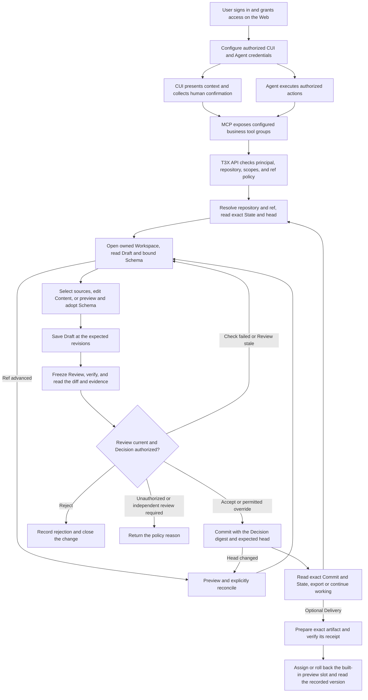

# T3X MCP Business Capabilities

This inventory covers single-user work. The conversational UI (CUI) is the interface a person uses to direct work and confirm specific actions. An Agent is an automated client that calls tools with its own authorized credential. After sign-in and authorization on the Web, both should be able to complete tasks within their authority, from locating a repository to reading back the exact result. Membership, invitations, sharing, pull requests, independent approvals, cross-branch merges, and collaboration policy are deferred.

GitHub MCP groups tools by business area and lets deployments enable or disable individual actions. T3X can use the same approach. Tool exposure is a deployment choice, while the T3X API authorizes each call. The proposed defaults are read access for identity, repositories, and State. Enable writing and other groups as needed, with separate controls for Decision and Commit. Read-only deployments expose only read operations and apply the same API authorization to resource reads. [GitHub MCP server configuration](https://github.com/github/github-mcp-server/blob/main/docs/server-configuration.md)

The current stdio server registers `core`, `advanced`, and `transition`. The last group is opt-in and requires the API backend. Resources and prompts register independently of tool groups. This inventory describes the authenticated API path. The `storage` backend still has compatibility paths that read and write the local database directly. [MCP entry point](../src/index.ts) · [Tool registry](../../../packages/mcp/src/server.ts) · [Compatibility admin tool](../../../packages/mcp/src/tools/advanced/admin.ts)

Implementation status is based on source at `ae7df1304`. **Web Chat** means the assistant embedded in Workspace. Its capabilities and standalone Web screens are identified separately. Where an API exists, the gap is exposing it to the client and verifying the complete workflow. [Web business contracts](../../web/docs/business.md) · [Reliable Workspace](../../../docs/architecture/reliable-workspace-gate-1.md)

## Proposed tool groups

| Group | Business capabilities | Exposure |
| --- | --- | --- |
| `context` | Identify the caller and explain credential scope or access failures | Read by default. Sign-in and credential management stay on the Web. |
| `repositories` | Find or create a personal repository, list branches, resolve the exact head, and create a working branch | Read by default. Enable creation separately. |
| `state` | Read exact committed Content and its Schema binding, inspect history, compare revisions, and export | Read by default. Restore through a new change. |
| `workspace` | Open an owned Workspace, read and edit Draft Content or relations, apply a candidate, and reconcile against a newer branch head | Enable writes as needed. Use the existing confirmation rules for destructive actions. |
| `schemas` | Find definitions and bindings, validate Content, save a definition candidate, preview its impact, and adopt it | Enable as needed. Public publication is deferred. |
| `sources` | Ingest task materials, select traceable evidence, generate a candidate, and handle source-preserving changes | Enable as needed. Enforce repository and source access. |
| `transitions` | Prepare a change from Draft or explicit operations, read fixed Review, verify, decide, commit, and confirm the result | Enable as needed. Authorize acceptance, rejection, override, and Commit independently. |
| `runs` | Validate an exact Draft or Commit, start a configured repository run, and read findings and evidence | Enable as needed. Authorize triggering and reading separately. |
| `delivery` | Prepare a committed artifact, read the receipt, assign it to the built-in preview slot, or roll back to a recorded version | Enable as needed. Separate receipt reads, preparation, deployment, and rollback. |

## Tool group details

### `context` · Identity and authorization

- **MCP today** — With `T3X_MCP_BACKEND=api`, the client sends `T3X_API_KEY` or the key from the shared CLI configuration as a Bearer credential. The API resolves the caller. [MCP backend](../../../packages/mcp/src/backend.ts)
- **Web Chat and reusable APIs** — The assistant chooses capabilities using the authenticated principal, operation authorization, and model capabilities. Web Settings provides token creation and revocation. MCP can reuse API identity and permission decisions. [Assistant route](../../../packages/api/src/routes/workspace-assistant.openapi.ts) · [API Tokens Settings](../../web/src/components/settings/ApiTokensSettingsPanel.tsx)
- **MCP gaps** — Provide a dedicated identity and scope diagnostic. The Web token form currently submits a name and optional project, so the API defaults to `transition_scopes=[]`. The Web must be able to issue the required scoped credentials before the authenticated authoring or Transition path can work end to end. For automatic Decision, the authorized setup also needs a ref policy that permits machine action. Policy administration is separate from routine tool calls. [Identity API](../../../packages/api/src/routes/auth-me.openapi.ts) · [Credential contract](../../../packages/api/src/schemas/api-key-contracts.ts) · [Transition authorization](../../../packages/api/src/lib/transition-authority.ts) · [Policy binding API](../../../packages/api/src/routes/transition-policy-bindings.openapi.ts)
- **Roles and permissions** — Viewers can read, editors can edit, and owners or admins can perform the management actions granted to their roles. Credentials further restrict those grants. CUI human actions and machine Agent actions use their respective credentials. Machine credentials require a project binding. Credentials linked to the same user can select the same `workspace_id` when authorized. The server resolves the actor and any delegator. A CUI confirmation must come through a trusted human request and identify the exact operation or Review. [Namespace roles](../../../docs/architecture/namespace-authority-v1.md#namespace-role-matrix) · [Request Principal contract](../../../docs/architecture/request-principal-migration-baseline.md#ingress-matrix) · [Workspace ownership](../../../packages/api/src/middleware/workspace-access.ts)

### `repositories` · Repositories and branches

- **MCP today** — `t3x_query` handles `projects`, `project`, and `branches`. In API mode, branch results include `head_commit_hash` (`null` on an empty branch) and an independent-review rule summary. The advanced `t3x_admin` tool supports `create_project` and `create_branch`. Creating a new branch via the API also initializes the caller's Workspace at the inherited basis. [Query tool](../../../packages/mcp/src/tools/core/query.ts) · [Admin tool](../../../packages/mcp/src/tools/advanced/admin.ts) · [Branch API](../../../packages/api/src/routes/branches.openapi.ts) · [Branch Workspace creation](../../../packages/api/src/lib/branch-workspace.ts)
- **Web Chat and reusable APIs** — Chat operates in an explicitly selected project and Workspace. Standalone Web navigation resolves repository addresses and branch context, and the Workspace page starts editing the selected branch. Reuse the address resolver and branch APIs for the CUI entry point. [Web navigation contract](../../web/docs/architecture.md#webui-navigation-and-addresses) · [Web Workspace flow](../../web/src/hooks/workspaces/useWorkspaceFlow.ts)
- **MCP gaps** — Resolve `owner/repo` and a branch together to a stable project identity and exact head. Branch creation currently exposes a parent branch name. Add the exact `head_commit_hash` input supported by the API. Repository metadata changes, archive, and restore remain follow-up management capabilities. [Repository addresses](../../../docs/repository-addresses.md) · [Branch API](../../../packages/api/src/routes/branches.openapi.ts)
- **Roles and permissions** — Repository reads follow `project:read` and the applicable public access policy. The authenticated create-repository route requires a human principal and `project:create` in the target namespace. An Agent works within an already authorized repository. Creating a branch requires project edit access. [Namespace roles](../../../docs/architecture/namespace-authority-v1.md#namespace-role-matrix) · [Repository API](../../../packages/api/src/routes/projects.openapi.ts)

### `state` · Committed State

- **MCP today** — `t3x_query` reads project-scoped `commit` and `commits`. A resource can read a selected Commit. The API Commit read includes a semantic Content projection. `t3x_diff` compares `base` and `target` in a project. Historical Leaf reads remain available. `t3x_generate` and `create_leaf` return a retirement error. [Query tool](../../../packages/mcp/src/tools/core/query.ts) · [Diff tool](../../../packages/mcp/src/tools/advanced/diff.ts) · [Commit API](../../../packages/api/src/routes/commits.openapi.ts) · [Retired generation tool](../../../packages/mcp/src/tools/core/generate.ts)
- **Web Chat and reusable APIs** — Chat can read the current Workspace's base structure by path. Standalone State and History provide committed Content and change inspection, and the Commit API exports exact YAML or JSON. Reuse the committed-State read and export APIs. [Chat capabilities](../../../packages/api/src/lib/workspace-assistant/capabilities.ts) · [State Overview](../../../packages/api/src/routes/state-overview.openapi.ts) · [Commit API](../../../packages/api/src/routes/commits.openapi.ts)
- **MCP gaps** — Read the complete business value and attached Schema identity at an exact Commit or State, and export exact State bytes. General structured restore needs an explicit operation that builds a new Draft or Proposal. `exact_source_revert` covers the source-preserving revert case. Exact author presentation reads and presentation-only revisions are separate State capabilities with an existing API. They can follow the core Content path. [Content representation](../../web/docs/business.md#b-06-content-representation-and-consistency) · [Exact State export](../../../docs/architecture/state-export.md) · [State presentations API](../../../packages/api/src/routes/state-presentations.openapi.ts)
- **Roles and permissions** — Apply project access to history and exports. A restore requires write authority and follows Transition checks and Decision before creating a new Commit. Presentation changes require project edit access and applicable ref authority. [Application authority](../../../docs/architecture/transition-application-convergence.md#one-authority-boundary) · [State presentations API](../../../packages/api/src/routes/state-presentations.openapi.ts)

### `workspace` · Draft and Content

- **MCP today** — `t3x_query` supports `workspaces`, `workspace`, and `workspace_activity`, including the base, current Draft, net diff, activity, and node history. The authoring view includes `currentSchema` when resolved. `t3x_edit` initializes a Draft in an existing Workspace, appends a precise YOps action, and supports reconciliation preview, adopt, cancel, discard, and explicit conflict resolution. [Query tool](../../../packages/mcp/src/tools/core/query.ts) · [Edit tool](../../../packages/mcp/src/tools/core/edit.ts) · [Authoring response](../../../packages/api-client/src/workspace-authoring.ts)
- **Web Chat and reusable APIs** — Chat reads base and current values by path and creates a Content candidate from a user's request. The frontend can apply an eligible candidate as a Draft action via `workspaces.authoring.publishCandidate`. Exact editing in Chat and MCP already uses the shared authoring service. [Chat capabilities](../../../packages/api/src/lib/workspace-assistant/capabilities.ts) · [Candidate publication and deletion confirmation](../../web/src/hooks/workspaces/useComposeActivity.ts)
- **MCP gaps** — Open or create an owned Workspace on a selected existing branch at the exact basis. `initialize_draft` takes an existing Workspace ID. Expose scoped Draft reads, candidate publication, and the existing deletion-confirmation command. Content CRUD works on Draft nodes and relations. Each write must comply with the bound Schema and any required confirmation. [Workspace API](../../../packages/api/src/routes/workspaces.openapi.ts) · [Authoring API](../../../packages/api/src/routes/workspace-authoring.openapi.ts)
- **Roles and permissions** — Require Workspace ownership and an explicit `workspace_id`. Authoring reads use `transition:inspect`. Draft writes, initialization, and reconciliation decisions require project edit access and `transition:propose`. Reconciliation preview uses project edit access and `transition:inspect`. The deletion-confirmation route requires a human principal. Writes bind a request ID and the required Workspace revision, composition revision, and ref head. Revalidate the complete Draft after conflict resolution. [Route authorization](../../../packages/api/route-policy.json) · [Workspace concurrency](../../web/docs/business.md#workspace-identity-and-concurrent-changes)

### `schemas` · Schema lifecycle

- **MCP today** — The Draft view can return the current binding. `t3x_edit mode=schema` uses `workspaces.authoring.publishSchema` to save one specific Schema action in the Workspace. Public publication goes through a separate API. [Edit tool](../../../packages/mcp/src/tools/core/edit.ts) · [Authoring API](../../../packages/api/src/routes/workspace-authoring.openapi.ts)
- **Web Chat and reusable APIs** — Chat reads the bound definition and can propose a specific field, relation, or rule change for human confirmation. Reuse the operation and version contracts behind that confirmation. Standalone Schema Studio provides candidate editing, preparation preview, adoption, and publication. [Chat capabilities](../../../packages/api/src/lib/workspace-assistant/capabilities.ts) · [Confirmation route](../../../packages/api/src/routes/workspace-assistant.openapi.ts) · [Schema Studio API](../../../packages/api/src/routes/schema-studio.openapi.ts)
- **MCP gaps** — Find versions by canonical name, read historical bindings, validate against a selected Schema, and expose the candidate save, impact preview, and adoption sequence. Public publishing and registry management are deferred. The single-user path ends with adoption and Commit within the repository. [Registry API](../../../packages/api/src/routes/yschema-composition.openapi.ts) · [Schema preparation API](../../../packages/api/src/routes/schema-preparation.openapi.ts) · [Adoption and publication contract](../../web/docs/business.md#b-04-schema-adoption-and-publication)
- **Roles and permissions** — Reads follow project permissions or public Schema rules. The exact Schema action path requires a human principal, `project:edit`, `transition:propose`, and current versions. Adoption is bound to the candidate, preview, and Draft revisions checked by the API. Agents can prepare suggestions, with any human-only confirmation performed by the authorized person in the CUI. [Authoring API](../../../packages/api/src/routes/workspace-authoring.openapi.ts) · [Adoption API](../../../packages/api/src/routes/schema-preparation.openapi.ts)

### `sources` · Materials and evidence

- **MCP today** — `t3x_query` reads `source_threads`, `source_thread`, and `source_evidence`. `t3x_extract` creates a candidate from an existing Workspace, Source Thread, and immutable turn hashes. `propose_transition` accepts that candidate, and supports exact-source import, scalar replacement, and revert proposals. [Source queries](../../../packages/mcp/src/tools/core/query.ts) · [Extraction tool](../../../packages/mcp/src/tools/core/extract.ts) · [Transition tools](../../../packages/mcp/src/tools/transition/index.ts)
- **Web Chat and reusable APIs** — Chat creates threads, records user input and document or image attachments, selects material, searches exact excerpts, and generates a Content candidate from the selected material. It can list available models. Reuse `sourceThreads.create/listTurns/appendTurn`, the material and model catalogs, upload, and governed proposal generation. [Chat intake](../../web/src/hooks/sourceThreads/useSourceThreadGeneration.ts) · [Source search](../../../packages/api/src/lib/workspace-assistant/capabilities.ts) · [Available models](../../web/src/hooks/shared/useAvailableModels.ts) · [API client](../../../packages/api-client/src/client.ts)
- **MCP gaps** — Ingest new text or attachments and return stable source IDs, turn IDs, and hashes. Expose project material reads, turn discovery, exact excerpts, and authorized model discovery. Provide a path that prepares source-preserving artifact and root references for a subsequent proposal. Pin tools can record context selections, with evidence resolved from the source records. Additional import previews and material lifecycle actions can follow as needed. [Source Evidence API](../../../packages/api/src/routes/source-evidence.openapi.ts) · [Materials API](../../../packages/api/src/routes/materials.openapi.ts) · [Import API](../../../packages/api/src/routes/import.openapi.ts) · [Exact-source Workspace API](../../../packages/api/src/routes/workspace-source-transition.openapi.ts)
- **Roles and permissions** — The API checks project and source access and the Workspace owner. Proposal creation requires `transition:propose`. Keep the actual source and authorship when recording inputs, including generated text. The server resolves verified evidence and Statement issuers. [Source Evidence API](../../../packages/api/src/routes/source-evidence.openapi.ts) · [Transition API](../../../packages/api/src/routes/transition-control-plane.openapi.ts)

### `transitions` · Propose, verify, decide, and commit

- **MCP today** — The `transition` group supports `propose_transition`, `inspect_transition`, `verify_transition`, `attach_statement`, `decide_transition`, and `commit_transition` through the API backend. The default `t3x_edit` mode creates a YOps proposal, and `t3x_commit` aliases Commit. Explicit operations and existing extraction candidates can use the direct Proposal path. [Transition tools](../../../packages/mcp/src/tools/transition/index.ts) · [Commit alias](../../../packages/mcp/src/tools/core/commit.ts)
- **Web Chat and reusable APIs** — Chat explains context and generates candidates. Standalone Workspace Review uses `workspaces.authoring.prepareReview` to turn the complete saved Draft into a verified Transition, then reads the fixed snapshot via `getLatestReviewSnapshot`. Reuse the prepare command and exact snapshot read. [Web Review controller](../../web/src/hooks/workspaces/useWorkspaceComposeReviewController.ts) · [Authoring API](../../../packages/api/src/routes/workspace-authoring.openapi.ts)
- **MCP gaps** — Prepare Review from the complete saved Draft, including adopted Schema, at the exact revisions and head. Retrieve the fixed snapshot by identity and surface its checks, preconditions, and Decision record. Carry the reviewed Transition through Decision and Commit, then return the Commit and updated Workspace and branch state. [Authoring Review service](../../../packages/api/src/lib/workspace-authoring-review.ts) · [ReviewSnapshot API](../../../packages/api/src/routes/workspaces.openapi.ts)
- **Roles and permissions** — Preparing Draft Review needs project edit access, `transition:propose`, and `transition:verify`. Inspection, verification, and Statement issuance respectively require `transition:inspect`, `transition:verify`, and `transition:statement:issue`. Decision requires `transition:decide:accept`, `transition:decide:reject`, or `transition:decide:override` for the requested outcome. Commit requires `transition:commit:create` and `transition:ref:advance`. Decision binds the fixed preconditions. Commit uses the Decision digest and expected head in a compare-and-swap. Nonhuman Decision requires an applicable server policy. Direct Decision on a proposal with a Proposal Generation record and any permitted override require a human principal. A ref that requires independent review stops at the policy decision. [Transition API](../../../packages/api/src/routes/transition-control-plane.openapi.ts) · [Decision policy](../../../packages/api/src/lib/transition-control-plane/applicable-policy.ts) · [Lifecycle](../../../packages/api/src/lib/transition-control-plane/lifecycle.ts)

### `runs` · Configured validation

- **MCP today** — `verify_transition` runs mandatory replay and applicable external checks. `inspect_transition` reads the resulting status. Independent Run actions are unexposed. [Transition tools](../../../packages/mcp/src/tools/transition/index.ts)
- **Web Chat and reusable APIs** — Workspace Chat offers context and candidates. The Web provides Workspace validation and repository Run screens. The API also supports YSchema validation of a specific Commit. These three paths can serve their respective subjects. [Workspace validation API](../../../packages/api/src/routes/workspace-validation.openapi.ts) · [Committed YSchema validation API](../../../packages/api/src/routes/yschema-validation.openapi.ts) · [Run API](../../../packages/api/src/routes/runs.openapi.ts)
- **MCP gaps** — Trigger validation for the exact Workspace version or Commit, return a run ID, and let callers read status, findings, and failure reasons. Repository Run listing, details, and triggering can follow as needed. Only evidence from an accepted issuer for the correct subject can satisfy a Review check. [Check and readiness contract](../../web/docs/business.md#b-07-check-scope-and-readiness)
- **Roles and permissions** — Triggering a run requires project write access and the applicable Workspace and run checks. Reading follows the run's project authorization. Runner callbacks use the service identity. [Route authorization](../../../packages/api/route-policy.json) · [Runner principal](../../../docs/architecture/request-principal-migration-baseline.md#ingress-matrix)

### `delivery` · Committed artifacts and preview

- **MCP today** — Commit reads and diffs can identify a committed result. Delivery preparation, receipts, and preview-slot operations have no registered tools. [Tool registry](../../../packages/mcp/src/server.ts)
- **Web Chat and reusable APIs** — Standalone Workspace Delivery lists targets and receipts, prepares or downloads artifacts, assigns a portable artifact to the built-in `preview` slot, and rolls back that slot. The shared API client exposes these operations separately. [Web Delivery](../../web/src/hooks/workspaces/useWorkspaceDelivery.ts) · [Delivery API](../../../packages/api/src/routes/workspace-deliveries.openapi.ts)
- **MCP gaps** — List authorized targets and receipts, prepare an artifact for the exact Commit, verify its bytes and digest, and return the immutable preparation receipt. Expose preview assignment, read-back of the actual artifact version, and rollback to a recorded digest. The portable bundle contains exact committed State and its verified Schema. A preview record proves which version the built-in slot points to. External runtime deployment and backup or restore are deferred. [Portable artifact contract](../../../docs/architecture/portable-artifact.md) · [Archive verification scope](../../../docs/architecture/project-archive-verification.md)
- **Roles and permissions** — Delivery routes require Workspace access. Listing needs `project:read`. Preparation, assignment, and rollback need `project:edit`. Preparation pins the Workspace revision and Commit digest and uses an idempotency key. Preview assignment consumes a successful portable receipt. Rollback appends a new record that selects a previous fixed version. [Delivery API](../../../packages/api/src/routes/workspace-deliveries.openapi.ts) · [Workspace ownership](../../../packages/api/src/middleware/workspace-access.ts)

## Single-user workflow after Web authorization

The diagram shows the target workflow. The CUI presents exact changes and collects human confirmation when required. An Agent executes actions allowed by its credential and ref policy. Both use the same T3X business commands as the Web client.

1. **Start from the repository.** The human may create a personal repository. Authorize a CUI and an Agent for that repository on the Web, including any ref policy needed for machine Decision. Both can locate the branch and select or open the user's Workspace, then read the exact basis and Schema binding. Exercise an empty ref and establish a Schema before reviewing Content.
2. **Complete a change.** Create, update, or delete Content in Draft, or save a Schema-only change. Prepare and read fixed Review, verify, record an authorized Decision, and Commit. Read back the exact Commit and its resulting Content and binding. A human uses the CUI for human-only steps. An Agent can finish a machine-eligible change when the ref policy allows it.
3. **Use evidence and deliver the result.** Ingest a source with traceable authorship, apply a candidate to Draft, and check its evidence in Review. Export the exact result. Where Delivery is enabled, prepare the portable artifact, read the receipt, and verify preview assignment and rollback by recorded digest.
4. **Recover and continue.** Exercise edits from two clients on the same Draft, a moving ref, failed checks, rejection, revoked or insufficient permission, and a lost response. Preserve usable Draft and evidence. Re-read authoritative state before retrying, reconciling, or preparing a fresh Review. A ref that requires independent review returns a policy block for the single-user workflow.

The core workflow depends on scoped Web credential issuance, opening an owned Workspace, preparing fixed Review from saved Draft, and reading the exact committed result. Schema candidates, source intake, independent runs, and artifact delivery extend that path. Authenticated CUI and Agent execution still needs end-to-end verification.
