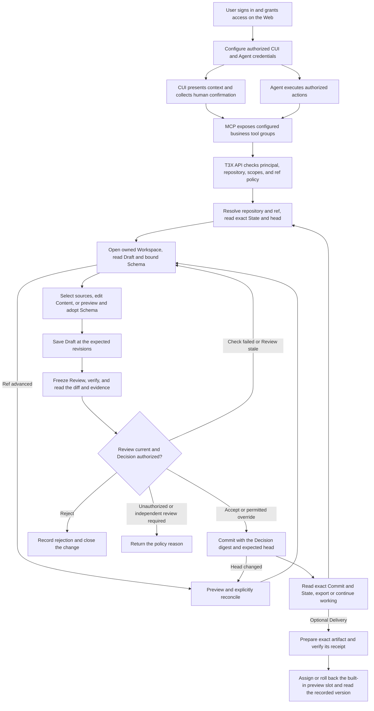

# T3X MCP Business Capabilities

This inventory covers single-user work. The conversational UI (CUI) is the interface a person uses to direct work and confirm specific actions. An Agent is an automated client that calls tools with its own authorized credential. After sign-in and authorization on the Web, both should be able to complete tasks within their authority, from locating a repository to reading back the exact result. Membership, invitations, sharing, pull requests, independent approvals, cross-branch merges, and collaboration policy are deferred.

GitHub MCP groups tools by business area and lets deployments enable or disable individual actions. T3X can use the same approach. Tool exposure is a deployment choice, while the T3X API authorizes each call. The proposed defaults are read access for identity, repositories, and State. Enable writing and other groups as needed, with separate controls for Decision and Commit. Read-only deployments expose only read operations and apply the same API authorization to resource reads. [GitHub MCP server configuration](https://github.com/github/github-mcp-server/blob/main/docs/server-configuration.md)

The legacy stdio configuration uses `core`, `advanced`, and `transition`. Set `T3X_MCP_CAPABILITIES` to opt into business capabilities through the authenticated API backend. The profile governs tool discovery, calls, and resource reads. The `storage` backend remains available to legacy configurations. [MCP entry point](../src/index.ts) · [Tool registry](../../../packages/mcp/src/server.ts) · [Compatibility admin tool](../../../packages/mcp/src/tools/advanced/admin.ts)

The inventory starts from source at `ae7df1304` and includes the repository, State, Workspace and Transition tools described below. **Web Chat** means the assistant embedded in Workspace. Its capabilities and standalone Web screens are identified separately. Where an API exists, the gap is exposing it to the client and verifying the complete workflow. [Web business contracts](../../web/docs/business.md) · [Reliable Workspace](../../../docs/architecture/reliable-workspace-gate-1.md)

## Proposed tool groups

| Group | Business capabilities | Exposure |
| --- | --- | --- |
| `context` | Identify the caller and explain credential scope or access failures | Read by default. Sign-in and credential management stay on the Web. |
| `repositories` | Find or create a personal repository, list branches, resolve the exact head, and create a working branch | Read by default. Enable creation separately. |
| `state` | Read exact committed Content and its Schema binding, inspect history, compare revisions, and export | Read by default. Restore through a new change. |
| `workspace` | Open an owned Workspace, read and edit Draft Content or relations, apply a candidate, and reconcile against a newer branch head | Enable writes as needed. Use the existing confirmation rules for destructive actions. |
| `schemas` | Find definitions and bindings, validate Content, save a definition candidate, preview its impact, and adopt it | Enable as needed. Public publication is deferred. |
| `sources` | Ingest task materials, select traceable evidence, generate a candidate, and handle source-preserving changes | Enable as needed. Enforce repository and source access. |
| `transitions` | Prepare a change from Draft or explicit operations, read fixed Review, verify, decide, commit, and confirm the result | Enable as needed. Authorize acceptance, rejection, override, and Commit independently. |
| `runs` | Validate an exact Draft or Commit, start a configured repository run, and read findings and evidence | Enable as needed. Authorize triggering and reading separately. |
| `delivery` | Prepare a committed artifact, read the receipt, assign it to the built-in preview slot, or roll back to a recorded version | Enable as needed. Separate receipt reads, preparation, deployment, and rollback. |

## Tool group details

### `context` · Identity and authorization

- **MCP today** — With `T3X_MCP_BACKEND=api`, the client sends `T3X_API_KEY` or the key from the shared CLI configuration as a Bearer credential. The API resolves the caller. `t3x_context` returns the current actor and credential kinds, binding and granted Transition scopes. Invalid, expired and revoked credentials receive HTTP 401. [MCP backend](../../../packages/mcp/src/backend.ts)
- **Web Chat and reusable APIs** — The assistant chooses capabilities using the authenticated principal, operation authorization, and model capabilities. Web Settings provides token creation and revocation. MCP can reuse API identity and permission decisions. [Assistant route](../../../packages/api/src/routes/workspace-assistant.openapi.ts) · [API Tokens Settings](../../web/src/components/settings/ApiTokensSettingsPanel.tsx)
- **Web authorization** — Web API Tokens can issue a project-bound Agent credential. Its initial expiration is seven days, with separate Decision and Commit scope selections and the existing project editor grant. Machine Decision requires a ref policy that permits the actor. Policy administration stays with the authorized human. [Identity API](../../../packages/api/src/routes/auth-me.openapi.ts) · [Credential contract](../../../packages/api/src/schemas/api-key-contracts.ts) · [Transition authorization](../../../packages/api/src/lib/transition-authority.ts) · [Policy binding API](../../../packages/api/src/routes/transition-policy-bindings.openapi.ts)
- **Roles and permissions** — Viewers can read, editors can edit, and owners or admins can perform the management actions granted to their roles. Credentials further restrict those grants. CUI human actions and machine Agent actions use their respective credentials. Machine credentials require a project binding. Credentials linked to the same user can select the same `workspace_id` when authorized. The server resolves the actor and any delegator. A CUI confirmation must come through a trusted human request and identify the exact operation or Review. [Namespace roles](../../../docs/architecture/namespace-authority-v1.md#namespace-role-matrix) · [Request Principal contract](../../../docs/architecture/request-principal-migration-baseline.md#ingress-matrix) · [Workspace ownership](../../../packages/api/src/middleware/workspace-access.ts)

### `repositories` · Repositories and branches

- **MCP today** — `t3x_query` handles `projects`, `project`, and `branches`. In API mode, branch results include `head_commit_hash` (`null` on an empty branch) and an independent-review rule summary. In API mode, `t3x_resolve_repository` resolves `owner/repo` and an explicit branch to the canonical path, project ID, and exact observed head. The advanced `t3x_admin` tool supports `create_project` and `create_branch`. Creating a new branch via the API also initializes the caller's Workspace at the inherited basis. [Query tool](../../../packages/mcp/src/tools/core/query.ts) · [Admin tool](../../../packages/mcp/src/tools/advanced/admin.ts) · [Branch API](../../../packages/api/src/routes/branches.openapi.ts) · [Branch Workspace creation](../../../packages/api/src/lib/branch-workspace.ts) · [Repository resolution tool](../../../packages/mcp/src/tools/repository-location.ts)
- **Web Chat and reusable APIs** — Chat operates in an explicitly selected project and Workspace. Standalone Web navigation resolves repository addresses and branch context, and the Workspace page starts editing the selected branch. Reuse the address resolver and branch APIs for the CUI entry point. [Web navigation contract](../../web/docs/architecture.md#webui-navigation-and-addresses) · [Web Workspace flow](../../web/src/hooks/workspaces/useWorkspaceFlow.ts)
- **Exact branch creation** — In API mode, pass an exact `head_commit_hash` to inherit an older Commit and initialize the caller’s Workspace at that basis. Repository and branch creation can be enabled independently. Repository metadata changes, archive, and restore remain follow-up management capabilities. [Repository addresses](../../../docs/repository-addresses.md) · [Branch API](../../../packages/api/src/routes/branches.openapi.ts)
- **Roles and permissions** — Repository reads follow `project:read` and the applicable public access policy. The authenticated create-repository route requires a human principal and `project:create` in the target namespace. An Agent works within an already authorized repository. Creating a branch requires project edit access. [Namespace roles](../../../docs/architecture/namespace-authority-v1.md#namespace-role-matrix) · [Repository API](../../../packages/api/src/routes/projects.openapi.ts)

### `state` · Committed State

- **MCP today** — `t3x_query` reads project-scoped `commit` and `commits`. A resource can read a selected Commit. The API Commit read includes a semantic Content projection. In API mode, `t3x_committed_state` reads the complete State value and verifies exact YAML or JSON exports for a pinned Commit. Its Schema binding action distinguishes verified identity, explicit absence, and insufficient evidence. `t3x_diff` compares `base` and `target` in a project. Historical Leaf reads remain available. `t3x_generate` and `create_leaf` return a retirement error. [Query tool](../../../packages/mcp/src/tools/core/query.ts) · [Diff tool](../../../packages/mcp/src/tools/advanced/diff.ts) · [Commit API](../../../packages/api/src/routes/commits.openapi.ts) · [Retired generation tool](../../../packages/mcp/src/tools/core/generate.ts) · [Committed State tool](../../../packages/mcp/src/tools/committed-state.ts)
- **Web Chat and reusable APIs** — Chat can read the current Workspace's base structure by path. Standalone State and History provide committed Content and change inspection, and the Commit API exports exact YAML or JSON. Reuse the committed-State read and export APIs. [Chat capabilities](../../../packages/api/src/lib/workspace-assistant/capabilities.ts) · [State Overview](../../../packages/api/src/routes/state-overview.openapi.ts) · [Commit API](../../../packages/api/src/routes/commits.openapi.ts)
- **MCP gaps** — General structured restore needs an explicit operation that builds a new Draft or Proposal. `exact_source_revert` covers the source-preserving revert case. Exact author presentation reads and presentation-only revisions are separate State capabilities with an existing API. They can follow the core Content path. [Content representation](../../web/docs/business.md#b-06-content-representation-and-consistency) · [Exact State export](../../../docs/architecture/state-export.md) · [State presentations API](../../../packages/api/src/routes/state-presentations.openapi.ts)
- **Roles and permissions** — Apply project access to history and exports. A restore requires write authority and follows Transition checks and Decision before creating a new Commit. Presentation changes require project edit access and applicable ref authority. [Application authority](../../../docs/architecture/transition-application-convergence.md#one-authority-boundary) · [State presentations API](../../../packages/api/src/routes/state-presentations.openapi.ts)

### `workspace` · Draft and Content

- **MCP today** — `t3x_query` supports `workspaces`, `workspace`, and `workspace_activity`, including the base, current Draft, net diff, activity, and node history. A JSON Pointer can select a value in the current Draft. `t3x_open_workspace` opens the caller’s private Workspace at an explicit branch head. The authoring view includes `currentSchema` when resolved. `t3x_edit` initializes a Draft in an existing Workspace, appends a precise YOps action, and supports reconciliation preview, adopt, cancel, discard, and explicit conflict resolution. [Query tool](../../../packages/mcp/src/tools/core/query.ts) · [Edit tool](../../../packages/mcp/src/tools/core/edit.ts) · [Authoring response](../../../packages/api-client/src/workspace-authoring.ts)
- **Web Chat and reusable APIs** — Chat reads base and current values by path and creates a Content candidate from a user's request. The frontend can apply an eligible candidate as a Draft action via `workspaces.authoring.publishCandidate`. Exact editing in Chat and MCP already uses the shared authoring service. [Chat capabilities](../../../packages/api/src/lib/workspace-assistant/capabilities.ts) · [Candidate publication and deletion confirmation](../../web/src/hooks/workspaces/useComposeActivity.ts)
- **Candidate publication** — `t3x_publish_candidate` applies an existing governed generation candidate to the owned Draft using the saved candidate facts and a caller request ID. Confirm an exact generated deletion in the signed-in Web Draft activity, then prepare a fresh Review. [Candidate tool](../../../packages/mcp/src/tools/workspace-candidate.ts) · [Authoring API](../../../packages/api/src/routes/workspace-authoring.openapi.ts)
- **Roles and permissions** — Require Workspace ownership and an explicit `workspace_id`. Authoring reads use `transition:inspect`. Draft writes, initialization, and reconciliation decisions require project edit access and `transition:propose`. Reconciliation preview uses project edit access and `transition:inspect`. The deletion-confirmation route requires a human principal. Writes bind a request ID and the required Workspace revision, composition revision, and ref head. Revalidate the complete Draft after conflict resolution. [Route authorization](../../../packages/api/route-policy.json) · [Workspace concurrency](../../web/docs/business.md#workspace-identity-and-concurrent-changes)

### `schemas` · Schema lifecycle

- **MCP today** — The Draft view can return the current binding. `t3x_edit mode=schema` uses `workspaces.authoring.publishSchema` to save one specific Schema action in the Workspace. Public publication goes through a separate API. [Edit tool](../../../packages/mcp/src/tools/core/edit.ts) · [Authoring API](../../../packages/api/src/routes/workspace-authoring.openapi.ts)
- **Web Chat and reusable APIs** — Chat reads the bound definition and can propose a specific field, relation, or rule change for human confirmation. Reuse the operation and version contracts behind that confirmation. Standalone Schema Studio provides candidate editing, preparation preview, adoption, and publication. [Chat capabilities](../../../packages/api/src/lib/workspace-assistant/capabilities.ts) · [Confirmation route](../../../packages/api/src/routes/workspace-assistant.openapi.ts) · [Schema Studio API](../../../packages/api/src/routes/schema-studio.openapi.ts)
- **Registry and candidate tools** — `t3x_schema_registry` lists authorized releases, reads one exact artifact, and validates supplied JSON Content structurally against its definition. S2 bindings identify historical definitions by digest. `t3x_schema_candidate` reads, previews, and saves an independent Workspace candidate. `t3x_schema_preparation` previews Content adaptations using the authoritative Draft. Adopt explicitly in signed-in Web, then prepare a fixed Review from the saved Draft. Public publishing and registry management are deferred. [Registry API](../../../packages/api/src/routes/yschema-composition.openapi.ts) · [Schema preparation API](../../../packages/api/src/routes/schema-preparation.openapi.ts) · [Adoption and publication contract](../../web/docs/business.md#b-04-schema-adoption-and-publication)
- **Roles and permissions** — Reads follow project permissions or public Schema rules. The exact Schema action path requires a human principal, `project:edit`, `transition:propose`, and current versions. Adoption is bound to the candidate, preview, and Draft revisions checked by the API. Agents can prepare suggestions, with any human-only confirmation performed by the authorized person in the CUI. [Authoring API](../../../packages/api/src/routes/workspace-authoring.openapi.ts) · [Adoption API](../../../packages/api/src/routes/schema-preparation.openapi.ts)

### `sources` · Materials and evidence

- **MCP today** — `t3x_query` reads `source_threads`, `source_thread`, and `source_evidence`. `t3x_extract` creates a candidate from an existing Workspace, Source Thread, and immutable turn hashes. `propose_transition` accepts that candidate, and supports exact-source import, scalar replacement, and revert proposals. [Source queries](../../../packages/mcp/src/tools/core/query.ts) · [Extraction tool](../../../packages/mcp/src/tools/core/extract.ts) · [Transition tools](../../../packages/mcp/src/tools/transition/index.ts)
- **Web Chat and reusable APIs** — Chat creates threads, records user input and document or image attachments, selects material, searches exact excerpts, and generates a Content candidate from the selected material. It can list available models. Reuse `sourceThreads.create/listTurns/appendTurn`, the material and model catalogs, upload, and governed proposal generation. [Chat intake](../../web/src/hooks/sourceThreads/useSourceThreadGeneration.ts) · [Source search](../../../packages/api/src/lib/workspace-assistant/capabilities.ts) · [Available models](../../web/src/hooks/shared/useAvailableModels.ts) · [API client](../../../packages/api-client/src/client.ts)
- **Exact Source reads** — In the `sources` capability, `t3x_source_context` lists project text materials, returns exact excerpts of one material or original user turn with the source identity, text digest and offsets, and reads the server's available model catalog. [Source context tool](../../../packages/mcp/src/tools/source-context.ts) · [Source Evidence API](../../../packages/api/src/routes/source-evidence.openapi.ts) · [Materials API](../../../packages/api/src/routes/materials.openapi.ts)
- **Agent ingestion** — `t3x_ingest_source` uses the project-bound Agent's authority to create a Source Thread, append machine-origin text at the expected parent, and upload attachments. Read the durable receipt by request ID after an interrupted response. Retrying a material upload leaves archival and existing creation attribution intact. Machine-origin records are excluded from original human Source evidence. [Source ingestion API](../../../packages/api/src/routes/source-ingestion.openapi.ts)
- **Governed generation** — Enable `sources:generate` to use `t3x_generate_proposal` with authorized material IDs or original user turn hashes and the exact saved Workspace revision. The API owns source resolution, model selection, and request retries. Generation returns the candidate Transition ID for separate application and Review. The existing `t3x_extract` compatibility tool continues to produce a direct Proposal. [Generation tool](../../../packages/mcp/src/tools/proposal-generation.ts) · [Transition API](../../../packages/api/src/routes/transition-control-plane.openapi.ts)
- **Exact-source selectors** — `t3x_source_artifact` prepares an import from a selected root file and materials, a scalar edit from the saved artifact, or a revert from the Workspace branch head. It checks paths and compares stored UTF-8 text against the material hash and any supplied original byte digest. Read parsed attachments through `t3x_source_context`. Submit the prepared selectors through the existing `propose_transition` tool, which checks source eligibility and derives the Effect on the server. [Artifact tool](../../../packages/mcp/src/tools/source-artifact.ts) · [Source Transition implementation](../../../packages/api/src/lib/workspace-source-transition.ts)
- **Roles and permissions** — The API checks project and source access and the Workspace owner. Proposal creation requires `transition:propose`. Keep the actual source and authorship when recording inputs, including generated text. The server resolves verified evidence and Statement issuers. [Source Evidence API](../../../packages/api/src/routes/source-evidence.openapi.ts) · [Transition API](../../../packages/api/src/routes/transition-control-plane.openapi.ts)

### `transitions` · Propose, verify, decide, and commit

- **MCP today** — The `transition` group supports `propose_transition`, `inspect_transition`, `verify_transition`, `attach_statement`, `decide_transition`, and `commit_transition` through the API backend. `t3x_draft_review` prepares the complete saved Draft at its exact revisions and ref basis and reads the fixed snapshot by ID. `t3x_commit_result` returns the exact Commit plus the currently observed branch and the Workspace if authorized. The default `t3x_edit` mode creates a YOps proposal, and `t3x_commit` aliases Commit. Explicit operations and existing extraction candidates can use the direct Proposal path. [Transition tools](../../../packages/mcp/src/tools/transition/index.ts) · [Commit alias](../../../packages/mcp/src/tools/core/commit.ts) · [Draft Review tool](../../../packages/mcp/src/tools/draft-review.ts)
- **Web Chat and reusable APIs** — Chat explains context and generates candidates. Standalone Workspace Review uses `workspaces.authoring.prepareReview` to turn the complete saved Draft into a verified Transition, then reads the fixed snapshot via `getLatestReviewSnapshot`. Reuse the prepare command and exact snapshot read. [Web Review controller](../../web/src/hooks/workspaces/useWorkspaceComposeReviewController.ts) · [Authoring API](../../../packages/api/src/routes/workspace-authoring.openapi.ts)
- **Qualification** — The core test exercises the authenticated stdio workflow, then uses a logged-in Web session for token issuance and fixed Review confirmation. Machine Decision is exercised with fixture refs and an explicit fixture policy. [Authoring Review service](../../../packages/api/src/lib/workspace-authoring-review.ts) · [ReviewSnapshot API](../../../packages/api/src/routes/workspaces.openapi.ts)
- **Roles and permissions** — Preparing Draft Review needs project edit access, `transition:propose`, and `transition:verify`. Inspection, verification, and Statement issuance respectively require `transition:inspect`, `transition:verify`, and `transition:statement:issue`. Decision requires `transition:decide:accept`, `transition:decide:reject`, or `transition:decide:override` for the requested outcome. Commit requires `transition:commit:create` and `transition:ref:advance`. Decision binds the fixed preconditions. Commit uses the Decision digest and expected head in a compare-and-swap. Nonhuman Decision requires an applicable server policy. Direct Decision on a proposal with a Proposal Generation record and any permitted override require a human principal. A ref that requires independent review stops at the policy decision. [Transition API](../../../packages/api/src/routes/transition-control-plane.openapi.ts) · [Decision policy](../../../packages/api/src/lib/transition-control-plane/applicable-policy.ts) · [Lifecycle](../../../packages/api/src/lib/transition-control-plane/lifecycle.ts)

### `runs` · Configured validation

- **MCP today** — `verify_transition` runs mandatory replay and applicable external checks. `t3x_commit_validation` independently validates an exact Commit with a supported YSchema name and version, then reports the resolved Schema digest, findings, and source provenance. Enable `runs:trigger` to start a Run and `runs` to read the persisted result by Run ID. [Commit validation tool](../../../packages/mcp/src/tools/commit-validation.ts)
- **Web Chat and reusable APIs** — Workspace Chat offers context and candidates. The Web provides Workspace validation and repository Run screens. The API also supports YSchema validation of a specific Commit. These three paths can serve their respective subjects. [Workspace validation API](../../../packages/api/src/routes/workspace-validation.openapi.ts) · [Committed YSchema validation API](../../../packages/api/src/routes/yschema-validation.openapi.ts) · [Run API](../../../packages/api/src/routes/runs.openapi.ts)
- **Exact Draft validation** — `t3x_workspace_validation` uses the existing ESPHome workflow with an exact Workspace revision and the composition revision when present. The API saves the captured revisions with the actual subject and input hashes. Use `runs:workspace:trigger` to start a Run and `runs:workspace` to read it by ID. The Run and its findings are private to the recorded Workspace owner with project access, including through project Checks. [Workspace validation tool](../../../packages/mcp/src/tools/workspace-validation.ts) · [Workspace validation API](../../../packages/api/src/routes/workspace-validation.openapi.ts)
- **Repository Run reads** — Enable `runs:repository` to list saved evaluation Runs by project and status or read one record by exact Run ID. The read tools return observed Run status, stored references and saved results. [Repository Runs tool](../../../packages/mcp/src/tools/repository-runs.ts)
- **Configured Run trigger** — An authenticated project editor with `runs:repository:trigger` can start a project-configured workflow for an exact CommitV2 and recover its Run using the original request ID. Only evidence from an accepted issuer for the correct subject can satisfy a Review check. [Check and readiness contract](../../web/docs/business.md#b-07-check-scope-and-readiness)
- **Roles and permissions** — Triggering a run requires project write access and the applicable Workspace and run checks. Reading follows the run's project authorization. Runner callbacks use the service identity. [Route authorization](../../../packages/api/route-policy.json) · [Runner principal](../../../docs/architecture/request-principal-migration-baseline.md#ingress-matrix)

### `delivery` · Committed artifacts and preview

- **MCP today** — Commit reads and diffs can identify a committed result. Delivery preparation, receipts, and preview-slot operations have no registered tools. [Tool registry](../../../packages/mcp/src/server.ts)
- **Web Chat and reusable APIs** — Standalone Workspace Delivery lists targets and receipts, prepares or downloads artifacts, assigns a portable artifact to the built-in `preview` slot, and rolls back that slot. The shared API client exposes these operations separately. [Web Delivery](../../web/src/hooks/workspaces/useWorkspaceDelivery.ts) · [Delivery API](../../../packages/api/src/routes/workspace-deliveries.openapi.ts)
- **MCP gaps** — List authorized targets and receipts, prepare an artifact for the exact Commit, verify its bytes and digest, and return the immutable preparation receipt. Expose preview assignment, read-back of the actual artifact version, and rollback to a recorded digest. The portable bundle contains exact committed State and its verified Schema. A preview record proves which version the built-in slot points to. External runtime deployment and backup or restore are deferred. [Portable artifact contract](../../../docs/architecture/portable-artifact.md) · [Archive verification scope](../../../docs/architecture/project-archive-verification.md)
- **Roles and permissions** — Delivery routes require Workspace access. Listing needs `project:read`. Preparation, assignment, and rollback need `project:edit`. Preparation pins the Workspace revision and Commit digest and uses an idempotency key. Preview assignment consumes a successful portable receipt. Rollback appends a new record that selects a previous fixed version. [Delivery API](../../../packages/api/src/routes/workspace-deliveries.openapi.ts) · [Workspace ownership](../../../packages/api/src/middleware/workspace-access.ts)

## Single-user workflow after Web authorization

The diagram shows the target workflow. The CUI presents exact changes and collects human confirmation when required. An Agent executes actions allowed by its credential and ref policy. Both use the same T3X business commands as the Web client.

1. **Start from the repository.** The human may create a personal repository. Authorize a CUI and an Agent for that repository on the Web, including any ref policy needed for machine Decision. Both can locate the branch and select or open the user's Workspace, then read the exact basis and Schema binding. Exercise an empty ref and establish a Schema before reviewing Content.
2. **Complete a change.** Create, update, or delete Content in Draft, or save a Schema-only change. Prepare and read fixed Review, verify, record an authorized Decision, and Commit. Read back the exact Commit and its resulting Content and binding. A human uses the CUI for human-only steps. An Agent can finish a machine-eligible change when the ref policy allows it.
3. **Use evidence and deliver the result.** Ingest a source with traceable authorship, apply a candidate to Draft, and check its evidence in Review. Export the exact result. Where Delivery is enabled, prepare the portable artifact, read the receipt, and verify preview assignment and rollback by recorded digest.
4. **Recover and continue.** Exercise edits from two clients on the same Draft, a moving ref, failed checks, rejection, revoked or insufficient permission, and a lost response. Preserve usable Draft and evidence. Re-read authoritative state before retrying, reconciling, or preparing a fresh Review. A ref that requires independent review returns a policy block for the single-user workflow.

The qualification runs against an isolated, authentication-enabled stack with test accounts, projects and refs. It checks API-issued credentials first and Web-issued Agent credentials second. Other CUI hosts, deployment credentials and policies require their own acceptance. Schema candidates, source intake, independent runs, and artifact delivery extend the core path. [MCP core qualification](../../web/e2e/security/mcp-core-loop.spec.ts)
